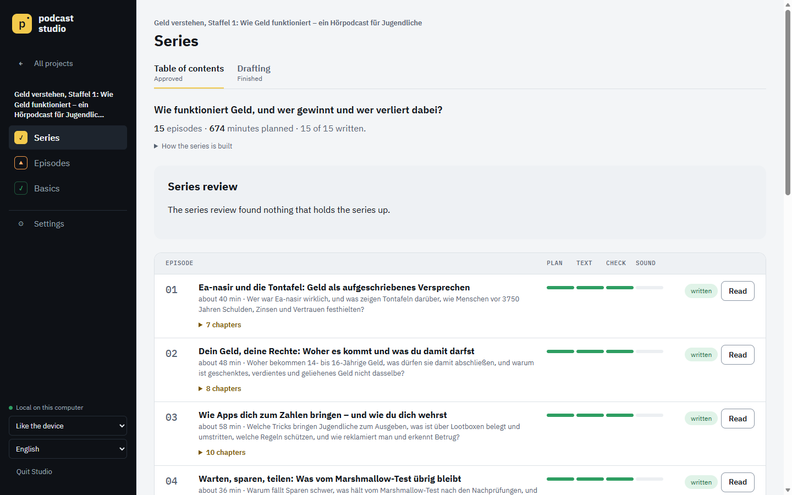
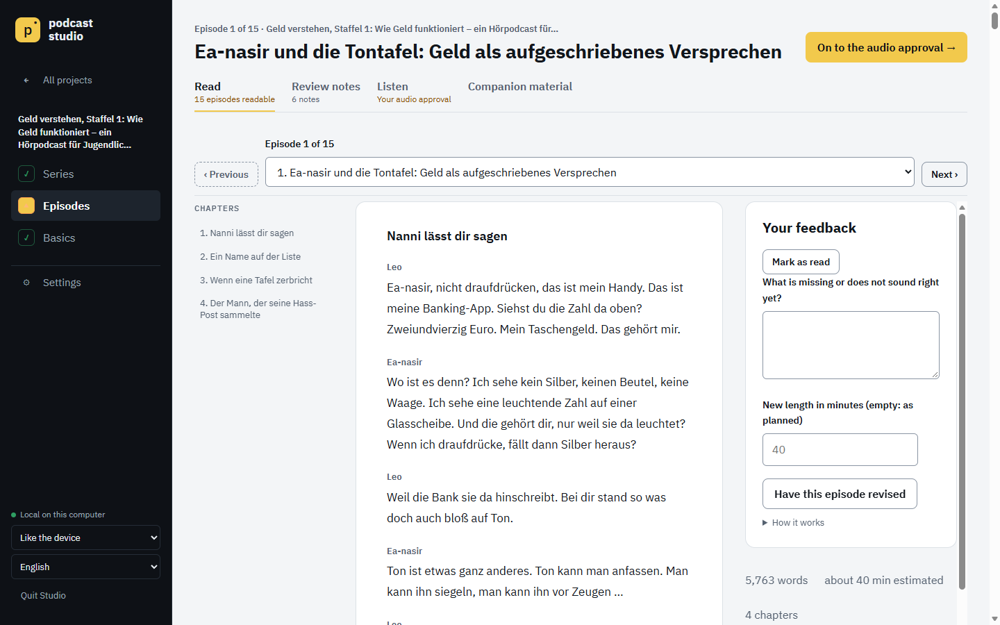
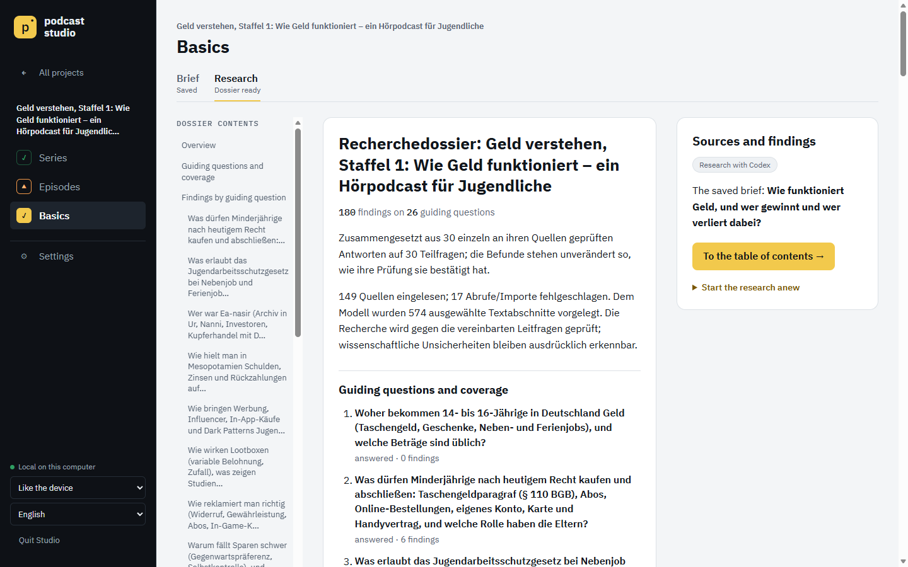

# Podcast Automate

[](https://github.com/Thorfinson/podcast-automate/actions/workflows/tests.yml)
[](LICENSE)


Podcast Automate turns a topic into a researched, reviewed dialogue podcast series and records it as MP3, on your own
computer. You give it a topic or a question. It collects and reads sources, builds an evidence-backed dossier, plans a
series, has a Claude Code agent write each episode as a dialogue of two or three hosts, reviews every script against
the sources and, once you have read and approved it, records it with synthetic voices.

**[▶ Listen to a sample](docs/media/sample-understanding-money-ep01-ch1.mp3)** (10:34 min, English, AI-generated):
the first chapter of a season on money for teenagers, in which a copper merchant from ancient Ur defends himself
against the world's oldest known customer complaint. [Transcript and how it was made](docs/media/sample-understanding-money-ep01-ch1.md).



```text
topic ─▶ research ─▶ table of contents ─▶ episode by episode: agent script, review ─▶ you read ─▶ recording ─▶ MP3
          (dossier)    (you approve)                                                  (you approve)
```

**Names.** Podcast Automate is the project and the Python package. Its web app is the **Podcast Studio** (the
Studio for short), started by the launchers or `pla studio`; `pla` is its command line.

## Who it is for

People who want to understand a topic in depth by listening, for their own learning, and who are comfortable
installing Python and a command-line tool. It is a single-user tool: no accounts, no hosting, no automatic publishing.
You read every script before it is recorded. The sources are cited, but an episode does not replace an expert's review.

**By design, the scripts are written by Claude.** Every episode is written by a Claude Code session (Claude Opus), so
writing needs either a Claude subscription logged in through the official Claude Code CLI or your own Anthropic API
key. Research, reviews and recording can run on other providers ([Story agent](docs/SCRIPTS.md#story-agent)).

## Try it first: a trial project

Install it (next section), then start with a trial project: in the Studio tick **Trial: a narrow topic, one short
episode** on the new-project page, or
run `pla init <project> --trial` (with `--topic "…"`, or without it for a narrow sample topic). A trial keeps research
and the series small: at most three sub-questions, one episode of at most 20 minutes, at most 110 model calls per run
and, where you set a money limit, at most 45 USD ([Trial project](docs/BUSINESS_LOGIC.md#trial-project)). It shows the
whole pipeline for a fraction of a series' cost.

## Quick start

| System | Setup | Start |
| --- | --- | --- |
| Windows 11 | [Install on Windows 11](docs/OPERATIONS.md#install-on-windows-11) | double-click `Podcast-Studio.cmd` |
| macOS | `brew install python@3.12 ffmpeg`, then `sh scripts/setup.sh` ([details](docs/OPERATIONS.md#install-on-macos-and-linux)) | double-click `Podcast-Studio.command` |
| Linux | Install Python 3.12 or later and FFmpeg, then `sh scripts/setup.sh` | `sh Podcast-Studio.sh` |

The Studio opens `http://127.0.0.1:8765` and is reachable only from this computer
([Studio access](docs/SECURITY.md#studio-access)). Keys go into the settings page; the Studio keeps them in your
operating system's credential store, never in project files. Set up your text access: [Claude Code](docs/OPERATIONS.md#claude-code),
[Codex](docs/OPERATIONS.md#codex), [Claude on your Anthropic API key](docs/OPERATIONS.md#claude-on-your-anthropic-api-key)
or [OpenRouter with Perplexity](docs/OPERATIONS.md#research-with-openrouter-and-perplexity); speech:
[Gemini via Google](docs/AUDIO.md#gemini-via-google) or [ElevenLabs](docs/AUDIO.md#elevenlabs). `pla doctor --skip-tts`
checks the installation without local Qwen. All commands: [PRODUCT](docs/PRODUCT.md#commands).

## What you need

- **Python 3.12 or newer and FFmpeg.** On Windows a script installs FFmpeg into the checkout.
- **Text access for the scripts:** a Claude subscription through the official Claude Code CLI, or your own Anthropic
  API key through Claude Code (`claude_api`, [experimental](#experimental-parts)).
- **Text access for research and reviews**, any of: the same Claude access; a ChatGPT subscription through the
  official Codex CLI; an OpenRouter key together with a Perplexity key for the web search
  ([experimental](#experimental-parts)).

  Subscriptions are used only through their official CLI logins, never through extracted tokens; check that your
  plan's terms cover this use.
- **One speech route**, any of:
  - Gemini through Google's API on your Google key (no GPU needed);
  - ElevenLabs on your ElevenLabs key (Eleven v4 or the cheaper v4 Turbo; the sample above);
  - Gemini through OpenRouter on your OpenRouter key;
  - local Qwen3-TTS on a GPU (tested on Windows with an AMD Radeon RX 9070 XT; the macOS and Linux setup is built but
    not yet listening-tested).

## What it costs

A full series is a big job. Measured with the same method on four real series
([Money limit](docs/BUSINESS_LOGIC.md#money-limit)):

| | Episodes | Model calls | Worth at API prices | Per episode | Text work |
| --- | --- | --- | --- | --- | --- |
| Three series, October 2026 | 14 to 19 | 1,389 to 1,771 | 605 to 809 USD, plus 40 to 200 USD of Codex calls | 42 to 58 USD | 78 to 89 h |
| "Geld verstehen", season 1, November 2026 | 15 (8.7 h of audio) | 873 | 784 USD with four revisions | 52 USD | 51 h |

Since the story agent writes the scripts (November 2026), a season needs about half the calls, and its research took
2.3 hours instead of 33 to 35 (it started from the library of an earlier research, which cost another 174 USD for
this season's share). But each episode's Claude Opus session costs about 20 USD, so a series costs about as much as
before; it is done much sooner. Recording season 1 with ElevenLabs took about 267,000 credits, about 94 EUR at a 100 EUR top-up.

- **On a subscription** there is no bill per call, but a series uses a lot of your plan's quota. A run pauses when the
  quota is used up and resumes after the reset.
- **On an API key** (Anthropic, OpenRouter, and Perplexity at about 0.005 USD per search request) every call is billed,
  and a billed run does not start without a money limit in USD per run.
- **Speech** through Google, ElevenLabs or OpenRouter runs on that key at the provider's prices; local Qwen costs
  nothing per episode.

## Experimental parts

> **Experimental:** Claude on your own Anthropic API key (`claude_api`) and the web search through Perplexity are
> implemented and tested against simulated APIs only; they are not yet verified against the real APIs. Open are, among
> others, whether every call really runs on the key, whether the counted cost matches the provider's bill, the error
> codes and rate limits, and whether Perplexity finds sources as good as a model's own search (V-29 to V-36 in the
> [verification list](docs/specs/2026-09-10-mvp-acceptance-plan.md#verification-list)). Use a trial project and a low
> money limit, and check the provider's own bill.

## Good to know

- **Languages.** The Studio's interface is in English or German: it follows your browser's language, or you fix one.
  A series is written and recorded in English or German, set per project, and everything its listeners get (file
  names, show notes, the companion kit) is in that language ([Languages](docs/ARCHITECTURE.md#languages)). The `pla`
  command line is English.
- **AI-generated content.** Scripts and voices are produced by AI models, and the exports are marked as AI-generated.
  Before you share an episode, check its facts, the rights of the quoted sources and your platform's rules for AI
  content ([Source rights and privacy](docs/SECURITY.md#source-rights-and-privacy)).
- **What leaves your computer.** Prompts go to the text provider you chose, search queries to Perplexity if you use
  it, the spoken text to the speech provider ([Trust boundaries](docs/SECURITY.md#trust-boundaries)).

| Reading an episode before it is recorded | The research dossier with its guiding questions |
| --- | --- |
|  |  |

## Docs

Start with the [overview in ARCHITECTURE](docs/ARCHITECTURE.md#in-five-minutes) for the big picture.

| File | Content |
| --- | --- |
| [docs/PRODUCT.md](docs/PRODUCT.md) | What it is for, capabilities, text and audio models, all `pla` commands, out of scope, roadmap |
| [docs/STUDIO.md](docs/STUDIO.md) | The browser Studio step by step: hold cards, stopping and resuming, progress, downloads |
| [docs/BUSINESS_LOGIC.md](docs/BUSINESS_LOGIC.md) | Cross-cutting rules: provider choice and quotas, budgets, approvals, resume, episode length |
| [docs/RESEARCH.md](docs/RESEARCH.md) | From topic to verified dossier: sub-questions, reviews, gap probe, evidence contracts |
| [docs/SCRIPTS.md](docs/SCRIPTS.md) | From dossier to reviewed dialogue: series plan, the story agent, writing a series in order, script and series review, revisions |
| [docs/TEACHING.md](docs/TEACHING.md) | Editorial standard and the teaching stage: story material, story research, orientation sheet, supplementary research |
| [docs/AUDIO.md](docs/AUDIO.md) | Recording with Qwen, Gemini or ElevenLabs: take checks, spoken forms, re-rendering, exports |
| [docs/QUALITY.md](docs/QUALITY.md) | Quality gates, assessment criteria, acceptance, evals |
| [docs/ARCHITECTURE.md](docs/ARCHITECTURE.md) | Pipeline stages, processes, provider adapters, data contracts, project and run folders |
| [docs/CONFIGURATION.md](docs/CONFIGURATION.md) | Where each setting lives: project brief, Studio settings, environment variables |
| [docs/SECURITY.md](docs/SECURITY.md) | What leaves the machine, Studio access, keys, local files, source rights |
| [docs/OPERATIONS.md](docs/OPERATIONS.md) | Runbooks: install on [Windows](docs/OPERATIONS.md#install-on-windows-11) or [macOS/Linux](docs/OPERATIONS.md#install-on-macos-and-linux), [local Qwen](docs/OPERATIONS.md#set-up-local-qwen-on-windows), [update](docs/OPERATIONS.md#update-the-studio), [logs](docs/OPERATIONS.md#logs-and-diagnosis), [release](docs/OPERATIONS.md#release-a-version) |
| [docs/DECISIONS.md](docs/DECISIONS.md) | All decisions and open questions |
| [docs/GOTCHAS.md](docs/GOTCHAS.md) | Pitfalls: symptom, cause, fix |
| [CHANGELOG.md](CHANGELOG.md) | User-visible changes |
| [AGENTS.md](AGENTS.md) | Commands, code layout, conventions and testing rules for contributors and coding agents |
| [CONTRIBUTING.md](CONTRIBUTING.md) | How to set up, test and propose a change, and how issues, pull requests and releases work |
| [SECURITY.md](SECURITY.md) | Supported versions and how to report a vulnerability privately |
| [CODE_OF_CONDUCT.md](CODE_OF_CONDUCT.md) | How we treat each other in issues and pull requests |

Plans with open work: [MVP acceptance](docs/specs/2026-09-10-mvp-acceptance-plan.md) (including the verification
list), [review-loop decision gates](docs/specs/2026-10-04-review-loop-decision-gates-plan.md),
[overviews and evidence levels](docs/specs/2026-10-21-overviews-and-evidence-levels-plan.md),
[narration](docs/specs/2026-10-23-narration-plan.md), [story agent](docs/specs/2026-10-27-story-agent-plan.md) and
[agent-only writer](docs/specs/2026-11-01-agent-only-writer-plan.md). Finished plans and the
quality audit of 19 September 2026 are in [docs/specs/](docs/specs/).

## Layout

| Path | Content |
| --- | --- |
| `src/podcast_automate/` | The `pla` CLI, the pipeline, the Studio server and its browser UI (`web/`), all prompts (`prompts/`) |
| `tests/` | Python and browser test suites; which to run when is in [AGENTS.md](AGENTS.md) |
| `evals/` | Real-model regression checks, run by hand ([QUALITY](docs/QUALITY.md#evals)) |
| `examples/` | Example projects to copy into `projects/`: [geld-podcast](examples/geld-podcast/README.md), a German podcast on money with three hosts |
| `scripts/` | Setup and maintenance scripts |
| `docs/` | The documentation above; dated plans and specs in `docs/specs/`, the sample and screenshots in `docs/media/` |
| `.github/` | CI and release workflows, issue and pull request templates, code owners, Dependabot |
| `projects/` | Your projects and their runs (git-ignored); structure in [ARCHITECTURE](docs/ARCHITECTURE.md#project-folder-layout) |

## Releases and updates

There is no hosted service: the Studio and the CLI run on your computer. A version tag `vX.Y.Z` builds the package,
runs both test suites and publishes it to PyPI as `podcast-automate`, with a GitHub release that carries the version's
[CHANGELOG](CHANGELOG.md) section. The package provides the same `pla` command; the launchers and the FFmpeg and Qwen
setup scripts come with a checkout, which the quick start above uses. To update a checkout, follow
[Update the Studio](docs/OPERATIONS.md#update-the-studio).

## Contributing and security

Contributions are welcome: [CONTRIBUTING.md](CONTRIBUTING.md) explains setup, tests, pull requests and how changes
reach `main`, and coding agents read [AGENTS.md](AGENTS.md). Questions and ideas go to
[Discussions](https://github.com/Thorfinson/podcast-automate/discussions), bugs to
[Issues](https://github.com/Thorfinson/podcast-automate/issues). Please report vulnerabilities privately as described
in [SECURITY.md](SECURITY.md), not in a public issue. Everyone taking part follows the
[Code of Conduct](CODE_OF_CONDUCT.md).

## License

MIT, see [LICENSE](LICENSE). The sample in `docs/media/` is AI-generated and, like the rest of the repository, under
the MIT license; the fonts in `src/podcast_automate/web/fonts/` keep their own license (IBM Plex, SIL Open Font
License 1.1).
